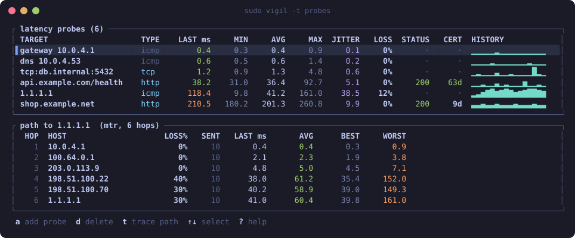

<div align="center">

# ◆ vigil

**The terminal monitor for people who run servers and debug networks.**

Processes, containers, services, users, sockets, open files, routes, latency and firewall counters on one screen,<br>
plus a layer-by-layer network doctor. One binary. `lsof` built in. Linux, macOS and Windows.

[](https://github.com/suleymenb/vigil/actions/workflows/ci.yml)
[](https://github.com/suleymenb/vigil/releases/latest)
[](LICENSE)


[Install](#install) · [Cookbook](#cookbook) · [Views](#views) · [Troubleshoot](#troubleshoot) · [Keys](#keys) · [Reports](#reports) · [Config](#configuration) · [Platforms](#platform-support) · [FAQ](#faq) · [Handbook](docs/handbook.html) · [Course](docs/course.html)

</div>

---

## Why vigil

- **Troubleshoot layer by layer.** `vigil doctor` (or `W`, `d`) walks the OSI layers bottom-up: link and NIC errors, ARP, IP, gateway, internet, path MTU, TCP, clock, TLS, DNS per resolver, HTTP. It names the lowest broken layer and the next command to run, with the Junos and Cisco equivalent.
- **Explains what you see.** Press `h` in any view: what `CLOSE_WAIT`, a `STALE` neighbour, a `D` process, an `OOM` event, a `DROP` rule, a health badge, a BGP neighbour going Idle or a filtered port means, and what to do about it.
- **Both ends of the cable.** `vigil snmp` shows a switch's ports, CRC errors, flaps and LLDP neighbours; `vigil syslog` receives its logs live; `vigil reach`, `trace --tcp`, `dhcp` and `wifi` answer the classic tickets ("is the firewall blocking it?", "is there a rogue DHCP server?", "is it the Wi-Fi?").
- **Built for incidents.** Health badges in the header tell you what's wrong before you start looking: memory, disk, inodes, file descriptors, ephemeral ports, disk latency, OOM kills, failed services, container throttling, retransmits, listen-queue drops, conntrack, packet loss, expiring certificates.
- **lsof built in.** Who uses this port, who holds this file, which deleted file is filling the disk: one keystroke or one flag.
- **Network internals without five other tools.** RTT, retransmits and bandwidth per connection (`ss -ti`), kernel counters (`nstat`), routes and neighbours (`ip`), latency and path probes (`ping`, `mtr`), HTTP and TLS checks (`curl`), firewall hits (`nft`) and one-key packet capture (`tcpdump`).
- **Containers and services without their daemons.** CPU, throttling, memory and OOM kills per container straight from cgroup v2; systemd units, restart loops, the journal and kernel events (`dmesg`) side by side.
- **Light.** About 2.5 % of one core and 16 MB of RAM at a 1 s refresh. Nothing is drawn when nothing changes.
- **One process, everything about it.** `Enter` opens the inspector: command, working directory, parents, unit, container, CPU/memory/fd history, sockets, open files, journal and environment (secrets hidden).
- **Readable reports.** `vigil report` writes a Markdown or JSON snapshot with findings and recommended actions; `--diff` shows what changed since an earlier report.

## Install

**Linux and macOS**, one line (x86_64/arm64, Apple Silicon/Intel):

```bash
curl -fsSL https://raw.githubusercontent.com/suleymenb/vigil/master/install.sh | sh
```

The script picks the right binary, checks its SHA-256 and installs to `/usr/local/bin`.
Install somewhere else with `VIGIL_INSTALL_DIR=~/.local/bin`, or a fixed version with `VIGIL_VERSION=v0.6.0`.

**Homebrew** (macOS and Linux), with the man page and shell completions:

```bash
brew install suleymenb/tap/vigil
```

**Cargo** (any OS with a Rust toolchain; the package is `vigil-tui` because `vigil` was taken on crates.io, the command is still `vigil`):

```bash
cargo install vigil-tui --locked
```

**Windows 10 / 11** (x64 and ARM64), in PowerShell, no administrator rights needed:

```powershell
irm https://raw.githubusercontent.com/suleymenb/vigil/master/install.ps1 | iex
```

The PowerShell script picks the binary for your CPU, verifies the SHA-256, installs `vigil.exe` to `%LOCALAPPDATA%\Programs\vigil` and adds it to your user `PATH`.

**Debian / Ubuntu** and **Fedora / RHEL / Rocky / Alma**: packages with the man page and shell completions:

```bash
curl -fsSLO https://github.com/suleymenb/vigil/releases/latest/download/vigil-amd64.deb && sudo apt install ./vigil-amd64.deb
```

```bash
sudo dnf install https://github.com/suleymenb/vigil/releases/latest/download/vigil-x86_64.rpm
```

(ARM: `vigil-arm64.deb`, `vigil-aarch64.rpm`.)

<details>
<summary><b>Manual download, or build from source</b></summary>

| Platform | Download |
|---|---|
| Linux x86_64 (static) | [vigil-linux-x86_64.tar.gz](https://github.com/suleymenb/vigil/releases/latest/download/vigil-linux-x86_64.tar.gz) |
| Linux arm64 (static) | [vigil-linux-arm64.tar.gz](https://github.com/suleymenb/vigil/releases/latest/download/vigil-linux-arm64.tar.gz) |
| macOS Apple Silicon | [vigil-macos-arm64.tar.gz](https://github.com/suleymenb/vigil/releases/latest/download/vigil-macos-arm64.tar.gz) |
| macOS Intel | [vigil-macos-x86_64.tar.gz](https://github.com/suleymenb/vigil/releases/latest/download/vigil-macos-x86_64.tar.gz) |
| Windows 10/11 x64 | [vigil-windows-x86_64.zip](https://github.com/suleymenb/vigil/releases/latest/download/vigil-windows-x86_64.zip) |
| Windows 10/11 ARM64 | [vigil-windows-arm64.zip](https://github.com/suleymenb/vigil/releases/latest/download/vigil-windows-arm64.zip) |
| Debian/Ubuntu | [vigil-amd64.deb](https://github.com/suleymenb/vigil/releases/latest/download/vigil-amd64.deb) · [vigil-arm64.deb](https://github.com/suleymenb/vigil/releases/latest/download/vigil-arm64.deb) |
| Fedora/RHEL | [vigil-x86_64.rpm](https://github.com/suleymenb/vigil/releases/latest/download/vigil-x86_64.rpm) · [vigil-aarch64.rpm](https://github.com/suleymenb/vigil/releases/latest/download/vigil-aarch64.rpm) |
| Completions + man page | [vigil-completions-and-man.tar.gz](https://github.com/suleymenb/vigil/releases/latest/download/vigil-completions-and-man.tar.gz) |

```bash
tar xzf vigil-*.tar.gz && sudo install -m 755 vigil-*/vigil /usr/local/bin/vigil
```

From source (needs a recent stable Rust toolchain):

```bash
cargo install --git https://github.com/suleymenb/vigil --locked
```

`cargo install` puts the binary in `~/.cargo/bin`, which `sudo` doesn't search. Use `sudo "$(which vigil)"` or the release binary above.

Shell completions and the man page come with the packages, or generate them:

```bash
vigil completions bash | sudo tee /etc/bash_completion.d/vigil >/dev/null   # also zsh, fish, powershell, elvish
vigil man | sudo tee /usr/local/share/man/man1/vigil.1 >/dev/null
```

</details>

Then run it:

```bash
sudo vigil
```

Root is optional, but without it lsof, sockets and firewall counters only show your own processes. On Windows run it from an elevated terminal to read the event log and every process.

## Cookbook

Every common question, as one command.

| I want to… | Run |
|---|---|
| See everything at a glance | `sudo vigil` |
| Find out where the network breaks (L1 → L7) | `vigil doctor` |
| Understand what a state, event or counter means | select it and press `h` |
| Find anything: a process, port, IP, MAC, service | press `F` and type |
| Calculate a subnet, split it, check membership | `vigil calc 10.0.0.0/22 /24` · `vigil calc 10.0.0.0/22 10.0.4.1` |
| See if my resolvers disagree or one is dead | `vigil dns github.com` · `vigil dns example.com MX @10.0.0.53` |
| Find the path MTU (PPPoE, VPN, black holes) | `vigil mtu 1.1.1.1` |
| Is the firewall letting it through? | `vigil reach 10.0.0.5 22,443,3389` |
| Where does TCP 443 stop on the way? | `sudo vigil trace app.example.com --tcp 443` |
| See a switch's ports, CRC errors, flaps and LLDP neighbours | `vigil snmp sw1` |
| Watch a router's logs live while you change it | `sudo vigil syslog` (Junos: `set system syslog host <ip> any any`) |
| Is there a rogue DHCP server? | `sudo vigil dhcp` |
| Is it the Wi-Fi? | `vigil wifi` |
| Is this link good enough for Teams/VoIP calls? | `vigil -t probes`: the **MOS** column |
| Capture traffic for Wireshark | `sudo vigil capture -i eth0 -t 30 port 443` (or `W`, `t`; Network view: `C`) |
| Watch live in Wireshark | `sudo vigil capture -w - port 53 \| wireshark -k -i -` |
| Capture a remote server in your local Wireshark | `ssh srv sudo vigil capture -w - port 443 \| wireshark -k -i -` |
| Measure throughput between two machines | `vigil perf --server` there, `vigil perf HOST -t 10 -P 4` here (`-R` for download) |
| See which switch port I'm plugged into, CRC errors, ARP changes | `vigil -t troubleshoot` (link layer panel) |
| See everything about one process | Procs view, select it, press `Enter` |
| Spot a memory or fd leak | `Enter` on the process: the inspector shows the trend, e.g. `+38 % in 2 min` |
| Find services still running old libraries after `apt upgrade` | `sudo vigil`: the `NEEDS RESTART` badge, details in the inspector |
| See who is logged in and who is guessing SSH passwords | `sudo vigil -t users` |
| See what my deploy changed | `vigil report -f json -o before.json`, deploy, then `vigil report --diff before.json` |
| Copy an IP, PID or command line | select it and press `y` (works over SSH) |
| Export the current table to CSV | press `E` |
| Find who is using port 8080 | `sudo vigil -q :8080` |
| Find who has a file open | `sudo vigil -q /var/log/syslog` |
| Find deleted files that still fill the disk | `sudo vigil -q +L1` |
| List everything one process has open | `sudo vigil -q 1234` |
| See every connection to one host | `sudo vigil -q @10.0.0.5` |
| Check what listens on all interfaces | `sudo vigil -t sockets`, then press `l` |
| Find slow or lossy connections | `sudo vigil -t sockets`, then `s` until the sort says **rtt** |
| See bandwidth per process | `sudo vigil -t procs`, then `w` |
| Ping the gateway, DNS and my own targets | `vigil -t probes`, then `a` to add one |
| See which firewall rule drops traffic | `sudo vigil -t firewall`, then `z` and `s` |
| Check routes, ARP/NDP and DNS servers | `vigil -t routes` |
| Capture one connection for Wireshark | Sockets view, select it, press `C` |
| Close one stuck connection | Sockets view, select it, press `D` |
| Write a report for an incident ticket | `sudo vigil report > incident.md` |
| Get machine-readable output | `vigil report -f json \| jq .findings` |
| Alert from cron when something is wrong | `vigil report --fail-on-alert -o /tmp/vigil.md \|\| mail -s "$(hostname)" ops@example.com < /tmp/vigil.md` |
| Find processes close to "Too many open files" | `sudo vigil -t procs`, then `e` |
| Check inodes ("disk full" with free space) | `vigil -t storage`, column **INODES** |
| See disk latency and utilisation (iostat) | `vigil -t storage`, table **devices** |
| See which container is CPU-throttled or OOM-killed | `sudo vigil -t containers` |
| See failed services and restart loops, with logs | `sudo vigil -t system` |
| See OOM kills, link flaps and NIC resets | `sudo vigil -t system`, then `e` |
| Check an HTTPS endpoint and its certificate expiry | `vigil -t probes`, `a`, then `https://api.example.com/health` |
| Trace the path to a target, loss per hop (mtr) | `vigil -t probes`, select it, press `t` |
| Use it over plain SSH or in tmux | `vigil --theme ansi` |
| Change the colours | press `T` |

## Views

Switch with `1`–`9`, `0`, `S`, `U`, `W`, `Tab`, `←` `→`, or click a tab.

| Key | View | What you see |
|:---:|---|---|
| `1` | **Overview** | CPU graph and per-core meters, memory, rx/tx graphs, top processes, listening ports, TCP states, disks |
| `2` | **Procs** | Sortable process table with CPU, memory, disk I/O, sockets, **bandwidth** and **open fds per process**; tree view; signals |
| `3` | **Network** | Interfaces with link speed, duplex, MTU, utilisation, drops and errors; TCP/UDP health counters; top talkers and peers |
| `4` | **Sockets** | Every connection with owner, state, **RTT, retransmits, queues and bandwidth**; container namespace; service names |
| `5` | **Files** | lsof queries by pid, port, path or raw arguments |
| `6` | **Storage** | Filesystem usage **and inodes**, **disk latency per device** (iostat), disk I/O per process, sensors |
| `7` | **Routes** | Routing table, neighbours (failed first), default gateways, DNS servers |
| `8` | **Probes** | ICMP, TCP, DNS and **HTTPS** probes with jitter, loss, **MOS call quality**, status code, **certificate expiry**, and an **mtr-style path trace** (TCP for TCP probes) |
| `9` | **Firewall** | nftables, iptables or pf rules with packets, bytes and live packets per second |
| `0` | **Containers** | Docker, containerd/Kubernetes, CRI-O, Podman: CPU, **throttling**, memory vs limit, **OOM kills**, I/O, network |
| `U` | **Users** | Logged-in sessions (who, from where, idle, running what), failed SSH logins in the last hour by source and the usernames tried, accepted logins |
| `S` | **System** | systemd / launchd / Windows services (failed and restarting first), the **journal** of the selected unit, and **kernel events** (Windows: the System event log): OOM kills, link flaps, NIC resets, segfaults, I/O errors, unexpected reboots |
| `W` | **Troubleshoot** | Twelve tools (doctor, subnet calc, MTU, DNS, reach, trace, SNMP, syslog, DHCP, Wi-Fi, perf, capture) next to a **link layer** panel: NIC error counters (CRC, frame, missed, flaps), **Wi-Fi** signal and roaming, **LLDP** neighbours (switch, port, VLAN) and an **ARP watch** that flags MAC changes |

Press `Enter` on any process (or `i` on a socket) for the **inspector**: identity, parent chain, children, systemd unit, container, cgroup, two-minute graphs of CPU, memory and open fds with a trend (`+38 % in 2 min` flags a leak), its sockets with RTT, open files, the unit's journal, and its environment with keys like `*_TOKEN` and `*_PASSWORD` hidden.



## Troubleshoot

Press `W` (or run the same tools from the shell). Nothing is contacted until you run a tool; the targets live in `[troubleshoot]` in the config.

| Key | Command | What it does |
|:---:|---|---|
| `d` | `vigil doctor` | Checks every layer bottom-up and names the lowest one that fails, with what it means and the next command (Linux, Junos, Cisco) |
| `c` | `vigil calc 10.0.0.0/22 /24` | Network, mask, wildcard, broadcast, host range, binary, supernet, PTR zone; splits into subnets; tests membership; IPv6 too |
| `m` | `vigil mtu HOST` | Path MTU with don't-fragment pings; explains the value (PPPoE, GRE, VXLAN, WireGuard, IPsec) and detects PMTU black holes |
| `n` | `vigil dns NAME [TYPE] [@server]` | Asks every configured resolver *and* public ones directly, compares answers, TTLs, DNSSEC flags and latency |
| `p` | `vigil perf HOST` | TCP throughput to a machine running `vigil perf --server` (iperf-style, per-second rates, parallel streams, reverse); blank = HTTP download test |
| `t` | `vigil capture` | Packet capture to a `.pcap` that Wireshark opens directly: any interface, BPF filter, a time or packet limit (`en0 30s port 443`, `500p host 10.0.0.5`). `C` in the Network view captures the selected interface |
| `r` | `vigil reach HOST PORTS` | Is a TCP port **open**, **refused** (RST: nothing listens or a firewall rejects) or **filtered** (silence: a firewall drops it)? `22,443,3389` · `8000-8010` · `ssh,https,rdp` |
| `e` | `vigil trace HOST [--tcp PORT \| --udp]` | The path hop by hop with loss and latency (mtr / traceroute / tracert); TCP or UDP get through firewalls that drop ICMP. Probes made as `tcp:host:port` trace with TCP automatically |
| `s` | `vigil snmp DEVICE` | A switch, router or firewall from the outside: every port's state, speed, traffic, utilisation, errors, **CRC/FCS**, discards, last change (flaps), duplex, the **LLDP neighbours** and CPU (Juniper, Cisco, generic), with findings. SNMP v2c and v3 (MD5/SHA/SHA-256, AES) |
| `l` | `vigil syslog` | A syslog receiver (UDP + TCP): point a device at this machine and watch **link flaps, OSPF/BGP/IS-IS neighbours, STP, err-disable, logins and commits** live, classified. Junos, Cisco, Arista, Aruba, Linux |
| `o` | `vigil dhcp` | Broadcasts a DHCP discover (from a random MAC, your lease is untouched) and lists every server that offers an address: **finds rogue DHCP servers** |
| `w` | `vigil wifi` | Wi-Fi signal (RSSI), noise, **SNR**, channel and band, PHY and rate, and roaming events in the link-layer panel |
| `x` | | stops a running capture or syslog receiver |

### The doctor

`vigil doctor` checks, in order:

| Layer | Checks |
|---|---|
| L1 Physical | link/carrier, speed and duplex (half duplex = negotiation mismatch), CRC / frame / collision / missed errors, link flaps |
| L2 Data link | gateway resolved in ARP (or `FAILED`: VLAN, port, port security), LLDP neighbour |
| L3 Network | usable IPv4 (169.254 = DHCP failed), default route, gateway and internet loss/latency, path MTU, IPv6 reachability |
| L4 Transport | TCP connect to the internet target (works while ping fails = ICMP filtered), retransmits and listen drops |
| L5/6 Session / TLS | clock skew against the web server's `Date` header, TLS handshake and certificate |
| L7 Application | system resolver, every DNS server directly, HTTP status and time to first byte, proxy variables |

`vigil doctor --json` prints the checks for scripts; the exit code is 1 when any check fails.

```text
L2 · Data link
  ✖ Gateway MAC        10.0.0.1: ARP failed
      → the gateway does not answer ARP: wrong VLAN on the switch port, gateway down, or a port-security / DAI block.
        Switch: show ethernet-switching table (Junos) · show mac address-table (Cisco)
...
11 passed · 1 warnings · 1 failed · 2.1 s
→ start at L2 Data link (Gateway MAC): the layers above depend on it
```

### Network devices: SNMP and syslog

```bash
vigil snmp 10.0.0.1                                        # v2c, community from [snmp] or "public"
vigil snmp sw1 -c s3cret -i 10                             # other community, 10 s sampling window
VIGIL_SNMP_AUTH=… VIGIL_SNMP_PRIV=… vigil snmp mx1 -u netops -a sha256   # SNMPv3 authPriv (AES)
sudo vigil syslog                                          # receive on UDP/TCP 514
vigil syslog -p 5514 -f ge-0/0/1 -w lab.log                # unprivileged port, filter, keep a raw copy
```

On the device: `set snmp community public authorization read-only` and `set system syslog host <vigil-ip> any any` (Junos), `snmp-server community public RO` and `logging host <vigil-ip>` (Cisco). For SNMPv3 put the user in `[snmp]` and the passwords in `VIGIL_SNMP_AUTH` / `VIGIL_SNMP_PRIV` (or the config file).

### Packet capture for Wireshark

```bash
sudo vigil capture -i eth0 -t 30 port 443                 # 30 s on eth0 → ./vigil-capture-<time>.pcap
sudo vigil capture -c 500 host 10.0.0.5 --open            # 500 packets, then open Wireshark
sudo vigil capture -w - udp port 53 | wireshark -k -i -   # live into Wireshark
ssh web1 sudo vigil capture -w - port 443 | wireshark -k -i -   # a remote server, live, in your local Wireshark
```

Linux and macOS use `tcpdump` (BPF filters: `port 443`, `host 10.0.0.5`, `tcp and not port 22`); Windows uses the built-in `pktmon` (Windows 10 2004+, administrator) and writes `.pcapng`, with `port`, `host` and `tcp`/`udp`/`icmp` filters. Without a limit the CLI captures until ctrl-c. macOS without sudo: install Wireshark's ChmodBPF.

## Health badges

A fixed row under the tabs shows a badge for every threshold that is crossed, on every view, most urgent first (`+N` when they don't fit). The tabs never move because of it. All thresholds live in the `[alerts]` section of the config; `0` turns a check off.

| Badge | Default | Meaning |
|---|---:|---|
| `MEM` / `SWAP` | 90 % / 50 % | Memory pressure |
| `DISK` | 90 % | Fullest filesystem |
| `LOAD` | 1.5 per core | Work is queueing |
| `RETRANS` | 2 % | TCP segments retransmitted: packet loss on a path |
| `LISTEN DROPS` | 1/s | Accept queue full: new connections silently dropped |
| `UDP DROPS` | 1/s | UDP socket buffers overflowing (DNS, syslog, metrics) |
| `CONNTRACK` | 80 % | Connection-tracking table nearly full |
| `CLOSE_WAIT` / `TIME_WAIT` | 100 / 20 000 | App not closing sockets / too many short connections |
| `<iface> DROPS` | 10/s | Interface dropping packets |
| `LOSS <probe>` | 20 % | A latency probe is losing packets (automatic gateway/DNS probes only once they have answered at least once: many routers never answer ping) |
| `PSI` | 20 % | Linux pressure stall: tasks waiting on CPU, memory or I/O |
| `TEMP` | 90 °C | Hottest sensor |
| `FDS <proc>` / `FILES` | 90 % / 80 % | A process near its open-file limit / system file table filling up |
| `EPHEMERAL PORTS` | 80 % | Local ports for outgoing connections running out |
| `INODES <mount>` | 90 % | Filesystem running out of inodes |
| `<dev> AWAIT` / `BUSY` | 100 ms / 95 % | Slow or saturated disk |
| `CERT <probe>` / `HTTP <probe>` | 21 days / 5xx | Certificate expiring / endpoint returning server errors |
| `THROTTLED <ctr>` / `OOM` | 25 % / any | Container hitting its CPU quota / a process was OOM-killed |
| `FAILED UNITS` | any | systemd units in the failed state |
| `NEEDS RESTART` | any | Processes still running a replaced binary or library after an update |
| `SSH FAILS` | 100 / hour | Failed SSH logins in the last hour |
| `<iface> ERR` | 1/s | NIC error counters rising (CRC, frame, missed): cable, optics or duplex |
| `GATEWAY MAC CHANGED` | on | The default gateway's MAC changed: VRRP/HSRP failover, a replaced router, or ARP spoofing |

## Keys

<table>
<tr><td valign="top">

**Everywhere**

| Key | Action |
|---|---|
| `1`–`9` `Tab` | switch view |
| `↑` `↓` `j` `k` | move (mouse wheel too) |
| `g` / `G` | top / bottom |
| `/` | filter the list |
| `:` | lsof query |
| `N` | reverse DNS on/off |
| `R` | write a report |
| `T` | theme picker |
| `space` | pause |
| `+` / `-` | refresh ±250 ms |
| `0` `S` `U` `W` | containers / system / users / troubleshoot |
| `F` | find anything, `↵` jumps there |
| `h` | explain the selected item |
| `y` | copy selected value |
| `E` | export view to CSV |
| `?` / `q` | help / quit |

`?` lists every key, the current view's first. It scrolls with the arrows or `PgUp` `PgDn` and searches with `/`. Everything in vigil works from the keyboard; the mouse is optional.

</td><td valign="top">

**Procs**

| Key | Action |
|---|---|
| `c` `m` `p` `n` | sort cpu, mem, pid, name |
| `u` `i` `o` `w` | sort user, io, sockets, net |
| `e` | sort by open fds |
| `r` | reverse sort |
| `t` | process tree |
| `↵` | inspector |
| `f` | open files |
| `x` | send signal |

**Probes**

| Key | Action |
|---|---|
| `a` / `d` | add / delete probe |
| `t` | trace the path (mtr) |

**System**

| Key | Action |
|---|---|
| `e` | units ⇄ kernel events |
| `↵` | reload the journal |

</td><td valign="top">

**Sockets**

| Key | Action |
|---|---|
| `l` | listening only |
| `s` | sort (… rtt, traffic) |
| `↵` | owner's open files |
| `P` | everything on this port |
| `i` | inspect the owner |
| `C` | capture (tcpdump) |
| `D` | close connection |
| `x` | signal owner |

**Firewall**

| Key | Action |
|---|---|
| `z` | rules with hits only |
| `s` | sort by packets/s |

**Troubleshoot**

| Key | Action |
|---|---|
| `d` | doctor |
| `c` `m` `n` `p` | calc, mtu, dns, perf |
| `t` | packet capture |
| `r` `e` | reach, trace |
| `s` `l` | SNMP device, syslog |
| `o` `w` | DHCP servers, Wi-Fi |
| `x` | stop a running tool |
| `y` | copy the output (or the selected line) |

**Network**

| Key | Action |
|---|---|
| `C` | capture this interface |

</td></tr>
</table>

### lsof query syntax

Press `:` in any view, or start with `-q`.

| You type | Runs | Use |
|---|---|---|
| `1234` | `lsof -nP -p 1234` | everything a process has open |
| `:8080` | `lsof -nP -i :8080` | who uses this port |
| `tcp:443` / `udp:53` | `lsof -nP -i tcp:443` | one protocol |
| `@10.0.0.5` | `lsof -nP -i @10.0.0.5` | all connections with a host |
| `/var/lib/docker` | `lsof -nP /var/lib/docker` | who has this path open |
| `+L1` | `lsof -nP +L1` | deleted files still taking space |
| `-u www-data -i` | `lsof -nP -u www-data -i` | any raw lsof arguments |

## Reports

`vigil report` samples the system for one second and prints a report: an overall status, a summary table, **findings with a recommended action each**, then processes, listening ports (with an *exposed* flag), connection states, slowest and busiest connections, kernel counters, interfaces and storage.

```bash
sudo vigil report > incident.md                 # Markdown for a ticket
vigil report -f json -o snapshot.json           # JSON for scripts and dashboards
vigil report --fail-on-alert                    # exit code 2 when a threshold is crossed
vigil report --top 25 --sample-ms 3000          # longer tables, longer sampling window
vigil report --diff before.json                 # what changed since an earlier JSON report
```

`--diff` lists new and resolved findings, ports that started or stopped listening, services that failed or recovered, containers that appeared or disappeared, noticeable shifts in memory, disks and connections, and new kernel events.

<details>
<summary><b>Example report (excerpt)</b></summary>

> # System report: prod-web-01
>
> > 🟠 **ATTENTION**: 2 warning finding(s) to review
> > Ubuntu 24.04.1 LTS · x86_64 · kernel 6.8.0-45-generic · up 41d 06:12 · 2026-11-25 10:12:03 UTC · vigil 0.3.0
>
> | Area | Measurement | Status |
> |---|---|---|
> | CPU | 38.2 % busy · load 1.84 / 1.62 / 1.40 (0.12 per core) | 🟢 OK |
> | Memory | 64 % used (20.1G of 31.3G), 11.2G available | 🟢 OK |
> | Connections | 1284 established · 611 TIME_WAIT · 14 CLOSE_WAIT | 🟢 OK |
> | TCP health | 3.10 % retransmitted · 0.0 listen overflows/s · 0.0 UDP drops/s | 🟠 Check |
> | Listening ports | 6 total, 4 on all interfaces | 🟠 Review |
>
> ### 1. 🟠 Warning: RETRANS 3.1%
> - **What it means:** TCP is retransmitting a high share of segments: packets are being lost on the path.
> - **Recommended action:** Look for interface errors/drops and congested links; compare RTT per connection in the Sockets view.
>
> ### 2. 🟠 Warning: PostgreSQL listens on all interfaces (port 5432)
> - **What it means:** postgres (pid 2290) is bound to *, so it is reachable from every network this host is on.
> - **Recommended action:** Bind it to 127.0.0.1 or a private interface, or make sure a firewall restricts the port.

</details>

## Themes

Press `T` for a live preview. `↑` `↓` to browse, `Enter` to keep, `b` for transparent background.

`tokyo-night` · `catppuccin-mocha` · `gruvbox` · `nord` · `dracula` · `rose-pine` · `kanagawa` · `everforest` · `one-dark` · `monokai` · `github-dark` · `solarized-dark` · `solarized-light` · `catppuccin-latte` · **`cyberpunk`** · **`phosphor`** · **`amber`** · **`okabe-ito`** · `ansi` · `classic`

- **cyberpunk**: neon on near-black, thick frames, `▰▱` meters.
- **phosphor** / **amber**: a green or amber CRT in pure ASCII (`+--+`, `[####....]`), monochrome, severity by brightness only.
- **solarized-light** / **catppuccin-latte**: light themes for bright rooms and projectors.
- **okabe-ito**: a colour-blind-safe palette (Okabe & Ito); no meaning depends on telling red from green.
- **ansi**: your terminal's own 16 colours, for plain SSH, tmux without truecolor and serial consoles. `auto` (the default) picks it only on terminals that can't do 24-bit colour.
- **classic**: the 16 colours with ASCII lines, for raster fonts and serial consoles.

Make your own in the config: start from any theme and override colours (`#rrggbb`, ANSI names like `light-red`, or `ansi:N`):

```toml
[[custom_themes]]
name = "noc-wall"
base = "nord"
glyphs = "neon"            # modern | neon | ascii
[custom_themes.colors]
bg = "#000000"
red = "#ff3355"
green = "light-green"
```

## Configuration

`~/.config/vigil/config.toml` (Windows: `%APPDATA%\vigil\config.toml`), created on first quit. Command-line flags win over the file. Under `sudo`, vigil uses the config of the user who ran sudo.

vigil detects the OS at start and lays a `[linux]`, `[macos]` or `[windows]` section over the shared settings, so one file can follow you everywhere (dotfiles, roaming profiles):

```toml
theme = "tokyo-night"
[windows]
theme = "classic"            # this machine only
[windows.alerts]
disk_pct = 95.0
[linux.network]
probes = ["tcp:db.internal:5432"]
```

Remap any key in `[keys]` (names like `F5`, `ctrl-k`, `alt-x`, `esc`, `pgdn` work):

```toml
[keys]
"F5" = "R"         # F5 writes a report
"ctrl-k" = "K"     # signal dialog
```

<details>
<summary><b>All options</b></summary>

```toml
theme = "auto"              # or any name from: vigil --list-themes
background = true           # false keeps your terminal's own background
glyphs = "auto"             # auto | theme | safe (basic console fonts) | ascii
interval_ms = 1000
lsof_interval_s = 3         # socket scan interval
start_tab = "overview"
proc_sort = "cpu"           # cpu mem pid name user io conn net
proc_desc = true
proc_tree = false
mouse = true

[network]
probes = ["1.1.1.1", "tcp:db.internal:5432", "dns:github.com", "https://api.example.com/health"]
auto_probes = true          # also ping default gateway(s) and DNS servers
probe_interval_s = 5
capture_seconds = 20        # length of a C capture
reverse_dns = false         # N toggles it

[alerts]                    # 0 disables a check
mem_pct = 90.0
swap_pct = 50.0
disk_pct = 90.0
load_per_core = 1.5
close_wait = 100
time_wait = 20000
temp_c = 90.0
psi_pct = 20.0
retrans_pct = 2.0
listen_drops_per_s = 1.0
udp_drops_per_s = 1.0
conntrack_pct = 80.0
iface_drops_per_s = 10.0
probe_loss_pct = 20.0
fd_pct = 90.0
files_pct = 80.0
ephemeral_pct = 80.0
inode_pct = 90.0
disk_await_ms = 100.0
disk_util_pct = 95.0
cert_days = 21.0
throttle_pct = 25.0
failed_units = true
needs_restart = true
ssh_failures_per_hour = 100
nic_errors_per_s = 1.0
gateway_mac_change = true

[snmp]                      # vigil snmp / s in Troubleshoot
version = "2c"              # or "3"
community = "public"        # VIGIL_SNMP_COMMUNITY overrides
port = 161
user = ""                   # SNMPv3
auth_protocol = "sha"       # md5, sha, sha256; passwords: auth_password / priv_password,
                            # or VIGIL_SNMP_AUTH / VIGIL_SNMP_PRIV (kept out of the file)

[troubleshoot]              # only contacted when you run a tool
internet_target = "1.1.1.1"
internet_target6 = "2606:4700:4700::1111"
dns_test_name = "example.com"
http_test_url = "https://example.com/"
public_resolvers = ["1.1.1.1", "8.8.8.8", "9.9.9.9"]
perf_url = "https://speed.cloudflare.com/__down?bytes=25000000"
```

</details>

<details>
<summary><b>Command-line flags</b></summary>

```
vigil [OPTIONS]
  -t, --tab <name>            start view: overview procs network sockets files storage routes probes firewall containers system users troubleshoot
  -q, --query <query>         run an lsof query at start, e.g. ":443" or "1234"
  -i, --interval <ms>         sampling interval (default 1000)
      --theme <name>          colour theme, or "auto"
      --list-themes           list themes and exit
      --config <path>         use another config file
      --no-save               don't write settings on quit
      --lsof-interval <sec>   socket scan interval (default 3)
      --lsof-sockets          use lsof -i instead of /proc/net (Linux)
      --no-mouse              disable the mouse

vigil report [-f md|json] [-o FILE] [--top N] [--sample-ms MS] [--fail-on-alert] [--diff FILE]
vigil doctor [--json]
vigil calc NET [/PREFIX | ADDR]
vigil dns NAME [TYPE] [@SERVER …]
vigil mtu [HOST]
vigil capture [-i IFACE] [-t SECS] [-c COUNT] [-w FILE|-] [--open] [BPF FILTER]
vigil reach HOST PORTS [-t MS]
vigil trace HOST [--tcp PORT | --udp]
vigil snmp DEVICE [-c COMMUNITY] [-u USER -a md5|sha|sha256 -A AUTH -x PRIV] [-p PORT] [-i SECS] [--all]
vigil syslog [-p PORT] [-f FILTER] [-w FILE]
vigil dhcp [-i IFACE] [-t SECS]
vigil wifi
vigil perf HOST [-t SECS] [-P STREAMS] [-R] [-p PORT] | --server [-p PORT] | --internet
vigil completions bash|zsh|fish|powershell|elvish
vigil man
```

</details>

## Platform support

vigil detects the OS and the helper tools (`lsof`, `tcpdump`, `mtr`, `lldpctl`, `nft`, `curl`, Docker, …) once at start; anything missing is explained in place instead of failing. The help screen (`?`) and every report list what this machine is missing.

| Feature | Linux | macOS | Windows 10/11 |
|---|:---:|:---:|:---:|
| Processes, CPU, memory, disks, sensors | ✅ | ✅ | ✅ |
| Sockets with owners | ✅ native `/proc/net` | ✅ `lsof` | ✅ IP Helper API |
| lsof queries (`:`) | ✅ | ✅ | – (Sysinternals `handle`) |
| RTT, retransmits, bandwidth per connection | ✅ sock_diag | – | – |
| Bandwidth per process | ✅ | ✅ `nettop` | – |
| Kernel counters (retrans %, listen drops, UDP drops) | ✅ + conntrack | ✅ (TCP needs root) | ✅ |
| Link speed, duplex, drops | ✅ | MTU | MTU |
| NIC error counters (CRC, frame, flaps) | ✅ | errors, collisions | errors |
| LLDP neighbours | ✅ `lldpd` | – | – |
| ARP watch (gateway MAC changes) | ✅ | ✅ | ✅ |
| Routes, neighbours, DNS | ✅ `ip -j` | ✅ `netstat`, `arp`, `ndp`, `scutil` | ✅ `route`, `arp`, `ipconfig` |
| Latency probes (ICMP, TCP, DNS, HTTPS) | ✅ | ✅ | ✅ (HTTPS needs curl: built in since 10 1803) |
| Path trace | ✅ mtr / traceroute | ✅ mtr / traceroute | ✅ tracert |
| Doctor, calc, DNS, MTU, perf | ✅ | ✅ | ✅ (MTU: IPv4) |
| Firewall counters | ✅ nft / iptables | ✅ pf | – (no per-rule counters) |
| Packet capture for Wireshark (`C`, `t`, `vigil capture`) | ✅ tcpdump | ✅ tcpdump | ✅ pktmon (.pcapng) |
| SNMP device polling, syslog receiver, port reachability | ✅ | ✅ | ✅ |
| Path trace with TCP / UDP | ✅ (TCP: root) | ✅ (TCP: root) | ICMP only |
| Rogue DHCP detection | ✅ root | ✅ | ✅ administrator |
| Wi-Fi signal, SNR, channel, roaming | ✅ `iw` | ✅ (SSID needs Location permission) | ✅ `netsh wlan` |
| Close one connection (`D`) | ✅ root | – | – |
| Disk latency per device (iostat) | ✅ | ✅ IOKit | – |
| Containers | ✅ cgroup v2 (Docker API on v1) | ✅ Docker Desktop API | ✅ Docker Desktop API |
| Services | ✅ systemd + journal | ✅ launchd | ✅ SCM + its events |
| Kernel / system events | ✅ `/dev/kmsg` | – | ✅ System event log |
| PSI pressure, needs-restart | ✅ | – | – |
| Logged-in users | ✅ | ✅ | ✅ `quser` |
| Failed / accepted SSH logins | ✅ journal | – | – |
| Signals | all | all | terminate |
| Copy (OSC 52), CSV export, mouse, search, explain | ✅ | ✅ | ✅ |

## FAQ

<details>
<summary><b><code>sudo: vigil: command not found</code></b></summary>

`sudo` only searches a fixed list of directories. Install to `/usr/local/bin` (the install script does this), or run `sudo "$(which vigil)"`.
</details>

<details>
<summary><b>Pressing <code>T</code> does nothing / the theme looks plain</b></summary>

Check `vigil --version`. Themes arrived in v0.2.1; an older copy may still be first in your `PATH` (`which -a vigil`). If you see your terminal's default colours, you're on the `ansi` theme: press `T`, pick one and press Enter.
</details>

<details>
<summary><b>Probes say "ICMP not permitted"</b></summary>

Unprivileged ping needs `net.ipv4.ping_group_range` to include your group, or run vigil as root. TCP probes (`tcp:host:port`) always work.
</details>

<details>
<summary><b>The Firewall view is empty</b></summary>

Reading rule counters needs root: `sudo vigil -t firewall`. Linux uses `nft`, then `iptables-save`; macOS uses `pfctl`.
</details>

<details>
<summary><b><code>C</code> or <code>D</code> fails</b></summary>

Capture needs `tcpdump` and root (Windows: `pktmon` in an administrator terminal). Files land in the current directory, else your home directory; `vigil capture --open` opens Wireshark when done. `D` needs root on Linux and a kernel with `CONFIG_INET_DIAG_DESTROY` (most distribution kernels have it).
</details>

<details>
<summary><b>The System view shows no kernel events</b></summary>

Reading `/dev/kmsg` needs root on most distributions (`kernel.dmesg_restrict = 1`): `sudo vigil -t system`.
</details>

<details>
<summary><b>HTTPS probes or the path trace don't work</b></summary>

HTTPS probes use `curl`; the path trace uses `mtr` if installed, otherwise `traceroute`. Install them with your package manager.
</details>

<details>
<summary><b><code>y</code> doesn't copy</b></summary>

Copying uses the terminal's OSC 52 clipboard escape, so it also works over SSH. Most terminals support it (iTerm2, WezTerm, kitty, Alacritty, Windows Terminal, recent GNOME Terminal). In tmux add `set -g set-clipboard on`; in iTerm2 allow "Applications in terminal may access clipboard".
</details>

<details>
<summary><b>Windows: empty boxes instead of graphs, or colours look wrong</b></summary>

Nothing to install. The classic console window (the blue PowerShell or `cmd` window, with Consolas or Lucida Console) has no fine block characters, so vigil draws with a simpler set there: plain corners and half-height graph steps. It picks that by itself; `vigil --glyphs safe` or `glyphs = "safe"` in the config forces it, `--glyphs ascii` goes all the way down to ASCII.

For the smooth graphs and 24-bit colour, run vigil in Windows Terminal (the default terminal on Windows 11, free in the Microsoft Store for Windows 10); its font, Cascadia Mono, has every character. vigil needs Windows 10 or 11.
</details>

<details>
<summary><b>Linux: boxes or question marks on the server's own console</b></summary>

The text console of a server or VM (`TERM=linux`: a monitor, IPMI/KVM, a hypervisor console) has a font of 256 or 512 characters. vigil switches to the same simple glyph set there by itself, and to the 16-colour `ansi` theme. Over SSH your own terminal draws, so you get the full set.
</details>

<details>
<summary><b>The doctor says "neighbour table is empty or unreadable"</b></summary>

The ARP table couldn't be read in this environment (some sandboxes and containers hide it). Run `arp -a` / `ip neigh` yourself to compare; the other checks still run.
</details>

<details>
<summary><b>How do I update?</b></summary>

Run the install one-liner again (Windows: the PowerShell line), `brew upgrade vigil`, or install the new `.deb` / `.rpm`. From source: `git pull && cargo install --path . --locked --force`.
</details>

## Performance

<details>
<summary><b>How vigil stays light</b></summary>

- Collectors run on background threads; the UI thread only handles keys and drawing.
- The screen is redrawn only when something changed: a key, a tick, or new data from a collector.
- Routes, firewall, containers, services and reverse DNS poll fast only while their view is open; in the background they refresh rarely, just enough for the health badges.
- On Linux, sockets come straight from `/proc/net` and netlink `sock_diag` instead of `lsof -i`.
- Socket and file lists are views of one shared snapshot: filtering stores indices, not copies.
- Tables only build the rows that are visible.
- Sensors are refreshed one by one instead of re-enumerated (108 ms → ~1 ms each on macOS).
- Per-process strings are cached per pid; a steady tick allocates almost nothing.

Measured on an Apple M4 Pro with ~860 processes: about 2.5 % of one core and 16 MB of RAM.
</details>

## Development

```bash
cargo test                                            # unit, render and real-kernel tests
cargo clippy --all-targets -- -D warnings
cargo run --release --example prof                    # collector micro-profile
python3 scripts/term2svg.py                           # regenerate README screenshots
```

CI runs clippy, the tests and a real packet capture on Linux x86_64, Linux arm64, macOS and Windows. Pushing a `v*` tag builds release binaries for all of them, `.deb` and `.rpm` packages, completions and the man page, with checksums.

Cross-check the other platforms locally: `cargo clippy --all-targets --target x86_64-pc-windows-gnu -- -D warnings` (and `x86_64-unknown-linux-musl`).

The [handbook](docs/handbook.html) explains the architecture, every view and step-by-step playbooks for DevOps and network incidents. The [course](docs/course.html) teaches vigil lesson by lesson, with quizzes, a key trainer, incident drills and a final exam (open the file in a browser).

## License

[MIT](LICENSE)
