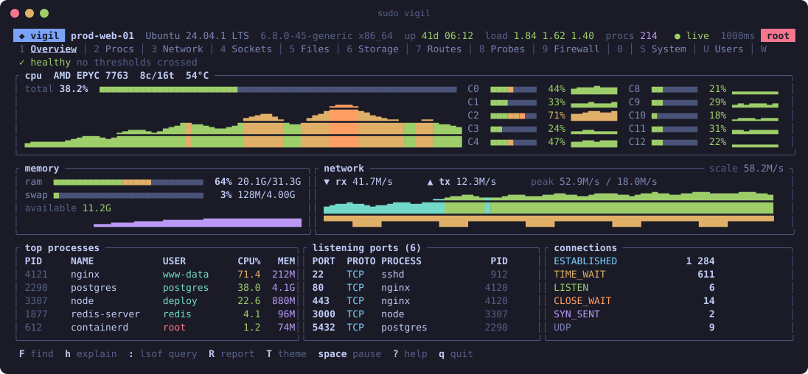

<div align="center">

# ◆ vigil

**The terminal monitor for people who run servers and debug networks.**

Processes, containers, services, users, sockets, open files, routes, latency and firewall counters on one screen.<br>
One static binary. `lsof` built in. Linux and macOS.

[](https://github.com/suleymenb/vigil/actions/workflows/ci.yml)
[](https://github.com/suleymenb/vigil/releases/latest)
[](LICENSE)




[Install](#install) · [Cookbook](#cookbook) · [Views](#views) · [Keys](#keys) · [Reports](#reports) · [Config](#configuration) · [FAQ](#faq) · [Handbook](docs/handbook.html) · [Course](docs/course.html)

</div>

---

## Why vigil

- **Built for incidents.** Health badges in the header tell you what's wrong before you start looking: memory, disk, inodes, file descriptors, ephemeral ports, disk latency, OOM kills, failed services, container throttling, retransmits, listen-queue drops, conntrack, packet loss, expiring certificates.
- **lsof built in.** Who uses this port, who holds this file, which deleted file is filling the disk: one keystroke or one flag.
- **Network internals without five other tools.** RTT, retransmits and bandwidth per connection (`ss -ti`), kernel counters (`nstat`), routes and neighbours (`ip`), latency and path probes (`ping`, `mtr`), HTTP and TLS checks (`curl`), firewall hits (`nft`) and one-key packet capture (`tcpdump`).
- **Containers and services without their daemons.** CPU, throttling, memory and OOM kills per container straight from cgroup v2; systemd units, restart loops, the journal and kernel events (`dmesg`) side by side.
- **Light.** About 2.5 % of one core and 16 MB of RAM at a 1 s refresh. Nothing is drawn when nothing changes.
- **One process, everything about it.** `Enter` opens the inspector: command, working directory, parents, unit, container, CPU/memory/fd history, sockets, open files, journal and environment (secrets hidden).
- **Readable reports.** `vigil report` writes a Markdown or JSON snapshot with findings and recommended actions; `--diff` shows what changed since an earlier report.

## Install

**One line** (Linux x86_64/arm64, macOS Apple Silicon/Intel):

```bash
curl -fsSL https://raw.githubusercontent.com/suleymenb/vigil/master/install.sh | sh
```

The script picks the right binary, checks its SHA-256 and installs to `/usr/local/bin`.
Install somewhere else with `VIGIL_INSTALL_DIR=~/.local/bin`, or a fixed version with `VIGIL_VERSION=v0.3.0`.

<details>
<summary><b>Manual download, or build from source</b></summary>

| Platform | Download |
|---|---|
| Linux x86_64 (static) | [vigil-x86_64-unknown-linux-musl.tar.gz](https://github.com/suleymenb/vigil/releases/latest/download/vigil-x86_64-unknown-linux-musl.tar.gz) |
| Linux arm64 (static) | [vigil-aarch64-unknown-linux-musl.tar.gz](https://github.com/suleymenb/vigil/releases/latest/download/vigil-aarch64-unknown-linux-musl.tar.gz) |
| macOS Apple Silicon | [vigil-aarch64-apple-darwin.tar.gz](https://github.com/suleymenb/vigil/releases/latest/download/vigil-aarch64-apple-darwin.tar.gz) |
| macOS Intel | [vigil-x86_64-apple-darwin.tar.gz](https://github.com/suleymenb/vigil/releases/latest/download/vigil-x86_64-apple-darwin.tar.gz) |

```bash
tar xzf vigil-*.tar.gz && sudo install -m 755 vigil-*/vigil /usr/local/bin/vigil
```

From source (needs a recent stable Rust toolchain):

```bash
cargo install --git https://github.com/suleymenb/vigil --locked
```

`cargo install` puts the binary in `~/.cargo/bin`, which `sudo` doesn't search. Use `sudo "$(which vigil)"` or the release binary above.

</details>

Then run it:

```bash
sudo vigil
```

Root is optional, but without it lsof, sockets and firewall counters only show your own processes.

## Cookbook

Every common question, as one command.

| I want to… | Run |
|---|---|
| See everything at a glance | `sudo vigil` |
| See everything about one process | Procs view, select it, press `Enter` |
| Spot a memory or fd leak | `Enter` on the process: the inspector shows the trend, e.g. `+38 % in 2 min` |
| Find services still running old libraries after `apt upgrade` | `sudo vigil`: the `NEEDS RESTART` badge, details in the inspector |
| See who is logged in and who is guessing SSH passwords | `sudo vigil -t users` |
| See what my deploy changed | `vigil report -f json -o before.json`, deploy, then `vigil report --diff before.json` |
| Copy an IP, PID or command line | select it and press `y` (works over SSH) |
| Export the current table to CSV | press `E` |
| Find who is using port 8080 | `sudo vigil -q :8080` |
| Find who has a file open | `sudo vigil -q /var/log/syslog` |
| Find deleted files that still fill the disk | `sudo vigil -q +L1` |
| List everything one process has open | `sudo vigil -q 1234` |
| See every connection to one host | `sudo vigil -q @10.0.0.5` |
| Check what listens on all interfaces | `sudo vigil -t sockets`, then press `l` |
| Find slow or lossy connections | `sudo vigil -t sockets`, then `s` until the sort says **rtt** |
| See bandwidth per process | `sudo vigil -t procs`, then `w` |
| Ping the gateway, DNS and my own targets | `vigil -t probes`, then `a` to add one |
| See which firewall rule drops traffic | `sudo vigil -t firewall`, then `z` and `s` |
| Check routes, ARP/NDP and DNS servers | `vigil -t routes` |
| Capture one connection for Wireshark | Sockets view, select it, press `C` |
| Close one stuck connection | Sockets view, select it, press `D` |
| Write a report for an incident ticket | `sudo vigil report > incident.md` |
| Get machine-readable output | `vigil report -f json \| jq .findings` |
| Alert from cron when something is wrong | `vigil report --fail-on-alert -o /tmp/vigil.md \|\| mail -s "$(hostname)" ops@example.com < /tmp/vigil.md` |
| Find processes close to "Too many open files" | `sudo vigil -t procs`, then `e` |
| Check inodes ("disk full" with free space) | `vigil -t storage`, column **INODES** |
| See disk latency and utilisation (iostat) | `vigil -t storage`, table **devices** |
| See which container is CPU-throttled or OOM-killed | `sudo vigil -t containers` |
| See failed services and restart loops, with logs | `sudo vigil -t system` |
| See OOM kills, link flaps and NIC resets | `sudo vigil -t system`, then `e` |
| Check an HTTPS endpoint and its certificate expiry | `vigil -t probes`, `a`, then `https://api.example.com/health` |
| Trace the path to a target, loss per hop (mtr) | `vigil -t probes`, select it, press `t` |
| Use it over plain SSH or in tmux | `vigil --theme ansi` |
| Change the colours | press `T` |

## Views

Switch with `1`–`9`, `0`, `S`, `U`, `Tab`, `←` `→`, or click a tab.

| Key | View | What you see |
|:---:|---|---|
| `1` | **Overview** | CPU graph and per-core meters, memory, rx/tx graphs, top processes, listening ports, TCP states, disks |
| `2` | **Procs** | Sortable process table with CPU, memory, disk I/O, sockets, **bandwidth** and **open fds per process**; tree view; signals |
| `3` | **Network** | Interfaces with link speed, duplex, MTU, utilisation, drops and errors; TCP/UDP health counters; top talkers and peers |
| `4` | **Sockets** | Every connection with owner, state, **RTT, retransmits, queues and bandwidth**; container namespace; service names |
| `5` | **Files** | lsof queries by pid, port, path or raw arguments |
| `6` | **Storage** | Filesystem usage **and inodes**, **disk latency per device** (iostat), disk I/O per process, sensors |
| `7` | **Routes** | Routing table, neighbours (failed first), default gateways, DNS servers |
| `8` | **Probes** | ICMP, TCP, DNS and **HTTPS** probes with jitter, loss, status code, **certificate expiry**, and an **mtr-style path trace** |
| `9` | **Firewall** | nftables, iptables or pf rules with packets, bytes and live packets per second |
| `0` | **Containers** | Docker, containerd/Kubernetes, CRI-O, Podman: CPU, **throttling**, memory vs limit, **OOM kills**, I/O, network |
| `U` | **Users** | Logged-in sessions (who, from where, idle, running what), failed SSH logins in the last hour by source and the usernames tried, accepted logins |
| `S` | **System** | systemd units (failed and restarting first), the **journal** of the selected unit, and **kernel events**: OOM kills, link flaps, NIC resets, segfaults, I/O errors |

Press `Enter` on any process (or `i` on a socket) for the **inspector**: identity, parent chain, children, systemd unit, container, cgroup, two-minute graphs of CPU, memory and open fds with a trend (`+38 % in 2 min` flags a leak), its sockets with RTT, open files, the unit's journal, and its environment with keys like `*_TOKEN` and `*_PASSWORD` hidden.


## Health badges

The right side of the tab row shows a badge for every threshold that is crossed, on every view. All thresholds live in the `[alerts]` section of the config; `0` turns a check off.

| Badge | Default | Meaning |
|---|---:|---|
| `MEM` / `SWAP` | 90 % / 50 % | Memory pressure |
| `DISK` | 90 % | Fullest filesystem |
| `LOAD` | 1.5 per core | Work is queueing |
| `RETRANS` | 2 % | TCP segments retransmitted: packet loss on a path |
| `LISTEN DROPS` | 1/s | Accept queue full: new connections silently dropped |
| `UDP DROPS` | 1/s | UDP socket buffers overflowing (DNS, syslog, metrics) |
| `CONNTRACK` | 80 % | Connection-tracking table nearly full |
| `CLOSE_WAIT` / `TIME_WAIT` | 100 / 20 000 | App not closing sockets / too many short connections |
| `<iface> DROPS` | 10/s | Interface dropping packets |
| `LOSS <probe>` | 20 % | A latency probe is losing packets |
| `PSI` | 20 % | Linux pressure stall: tasks waiting on CPU, memory or I/O |
| `TEMP` | 90 °C | Hottest sensor |
| `FDS <proc>` / `FILES` | 90 % / 80 % | A process near its open-file limit / system file table filling up |
| `EPHEMERAL PORTS` | 80 % | Local ports for outgoing connections running out |
| `INODES <mount>` | 90 % | Filesystem running out of inodes |
| `<dev> AWAIT` / `BUSY` | 100 ms / 95 % | Slow or saturated disk |
| `CERT <probe>` / `HTTP <probe>` | 21 days / 5xx | Certificate expiring / endpoint returning server errors |
| `THROTTLED <ctr>` / `OOM` | 25 % / any | Container hitting its CPU quota / a process was OOM-killed |
| `FAILED UNITS` | any | systemd units in the failed state |
| `NEEDS RESTART` | any | Processes still running a replaced binary or library after an update |
| `SSH FAILS` | 100 / hour | Failed SSH logins in the last hour |

## Keys

<table>
<tr><td valign="top">

**Everywhere**

| Key | Action |
|---|---|
| `1`–`9` `Tab` | switch view |
| `↑` `↓` `j` `k` | move (mouse wheel too) |
| `g` / `G` | top / bottom |
| `/` | filter the list |
| `:` | lsof query |
| `N` | reverse DNS on/off |
| `R` | write a report |
| `T` | theme picker |
| `space` | pause |
| `+` / `-` | refresh ±250 ms |
| `0` `S` `U` | containers / system / users |
| `y` | copy selected value |
| `E` | export view to CSV |
| `?` / `q` | help / quit |

</td><td valign="top">

**Procs**

| Key | Action |
|---|---|
| `c` `m` `p` `n` | sort cpu, mem, pid, name |
| `u` `i` `o` `w` | sort user, io, sockets, net |
| `e` | sort by open fds |
| `r` | reverse sort |
| `t` | process tree |
| `↵` | inspector |
| `f` | open files |
| `x` | send signal |

**Probes**

| Key | Action |
|---|---|
| `a` / `d` | add / delete probe |
| `t` | trace the path (mtr) |

**System**

| Key | Action |
|---|---|
| `e` | units ⇄ kernel events |
| `↵` | reload the journal |

</td><td valign="top">

**Sockets**

| Key | Action |
|---|---|
| `l` | listening only |
| `s` | sort (… rtt, traffic) |
| `↵` | owner's open files |
| `P` | everything on this port |
| `i` | inspect the owner |
| `C` | capture (tcpdump) |
| `D` | close connection |
| `x` | signal owner |

**Firewall**

| Key | Action |
|---|---|
| `z` | rules with hits only |
| `s` | sort by packets/s |

</td></tr>
</table>

### lsof query syntax

Press `:` in any view, or start with `-q`.

| You type | Runs | Use |
|---|---|---|
| `1234` | `lsof -nP -p 1234` | everything a process has open |
| `:8080` | `lsof -nP -i :8080` | who uses this port |
| `tcp:443` / `udp:53` | `lsof -nP -i tcp:443` | one protocol |
| `@10.0.0.5` | `lsof -nP -i @10.0.0.5` | all connections with a host |
| `/var/lib/docker` | `lsof -nP /var/lib/docker` | who has this path open |
| `+L1` | `lsof -nP +L1` | deleted files still taking space |
| `-u www-data -i` | `lsof -nP -u www-data -i` | any raw lsof arguments |

## Reports

`vigil report` samples the system for one second and prints a report: an overall status, a summary table, **findings with a recommended action each**, then processes, listening ports (with an *exposed* flag), connection states, slowest and busiest connections, kernel counters, interfaces and storage.

```bash
sudo vigil report > incident.md                 # Markdown for a ticket
vigil report -f json -o snapshot.json           # JSON for scripts and dashboards
vigil report --fail-on-alert                    # exit code 2 when a threshold is crossed
vigil report --top 25 --sample-ms 3000          # longer tables, longer sampling window
vigil report --diff before.json                 # what changed since an earlier JSON report
```

`--diff` lists new and resolved findings, ports that started or stopped listening, services that failed or recovered, containers that appeared or disappeared, noticeable shifts in memory, disks and connections, and new kernel events.

<details>
<summary><b>Example report (excerpt)</b></summary>

> # System report: prod-web-01
>
> > 🟠 **ATTENTION**: 2 warning finding(s) to review
> > Ubuntu 24.04.1 LTS · x86_64 · kernel 6.8.0-45-generic · up 41d 06:12 · 2026-11-25 10:12:03 UTC · vigil 0.3.0
>
> | Area | Measurement | Status |
> |---|---|---|
> | CPU | 38.2 % busy · load 1.84 / 1.62 / 1.40 (0.12 per core) | 🟢 OK |
> | Memory | 64 % used (20.1G of 31.3G), 11.2G available | 🟢 OK |
> | Connections | 1284 established · 611 TIME_WAIT · 14 CLOSE_WAIT | 🟢 OK |
> | TCP health | 3.10 % retransmitted · 0.0 listen overflows/s · 0.0 UDP drops/s | 🟠 Check |
> | Listening ports | 6 total, 4 on all interfaces | 🟠 Review |
>
> ### 1. 🟠 Warning: RETRANS 3.1%
> - **What it means:** TCP is retransmitting a high share of segments: packets are being lost on the path.
> - **Recommended action:** Look for interface errors/drops and congested links; compare RTT per connection in the Sockets view.
>
> ### 2. 🟠 Warning: PostgreSQL listens on all interfaces (port 5432)
> - **What it means:** postgres (pid 2290) is bound to *, so it is reachable from every network this host is on.
> - **Recommended action:** Bind it to 127.0.0.1 or a private interface, or make sure a firewall restricts the port.

</details>

## Themes

Press `T` for a live preview. `↑` `↓` to browse, `Enter` to keep, `b` for transparent background.

`tokyo-night` · `catppuccin-mocha` · `gruvbox` · `nord` · `dracula` · `rose-pine` · `solarized-light` · **`cyberpunk`** · **`phosphor`** · `ansi`

- **cyberpunk**: neon on near-black, thick frames, `▰▱` meters.
- **phosphor**: a green CRT in pure ASCII (`+--+`, `[####....]`), monochrome, severity by brightness only.
- **ansi**: your terminal's own 16 colours, for plain SSH, tmux without truecolor and serial consoles. `auto` (the default) picks it only on terminals that can't do 24-bit colour.

## Configuration

`~/.config/vigil/config.toml`, created on first quit. Command-line flags win over the file. Under `sudo`, vigil uses the config of the user who ran sudo.

<details>
<summary><b>All options</b></summary>

```toml
theme = "auto"              # or any name from: vigil --list-themes
background = true           # false keeps your terminal's own background
interval_ms = 1000
lsof_interval_s = 3         # socket scan interval
start_tab = "overview"
proc_sort = "cpu"           # cpu mem pid name user io conn net
proc_desc = true
proc_tree = false
mouse = true

[network]
probes = ["1.1.1.1", "tcp:db.internal:5432", "dns:github.com", "https://api.example.com/health"]
auto_probes = true          # also ping default gateway(s) and DNS servers
probe_interval_s = 5
capture_seconds = 20        # length of a C capture
reverse_dns = false         # N toggles it

[alerts]                    # 0 disables a check
mem_pct = 90.0
swap_pct = 50.0
disk_pct = 90.0
load_per_core = 1.5
close_wait = 100
time_wait = 20000
temp_c = 90.0
psi_pct = 20.0
retrans_pct = 2.0
listen_drops_per_s = 1.0
udp_drops_per_s = 1.0
conntrack_pct = 80.0
iface_drops_per_s = 10.0
probe_loss_pct = 20.0
fd_pct = 90.0
files_pct = 80.0
ephemeral_pct = 80.0
inode_pct = 90.0
disk_await_ms = 100.0
disk_util_pct = 95.0
cert_days = 21.0
throttle_pct = 25.0
failed_units = true
needs_restart = true
ssh_failures_per_hour = 100
```

</details>

<details>
<summary><b>Command-line flags</b></summary>

```
vigil [OPTIONS]
  -t, --tab <name>            start view: overview procs network sockets files storage routes probes firewall containers system users
  -q, --query <query>         run an lsof query at start, e.g. ":443" or "1234"
  -i, --interval <ms>         sampling interval (default 1000)
      --theme <name>          colour theme, or "auto"
      --list-themes           list themes and exit
      --config <path>         use another config file
      --no-save               don't write settings on quit
      --lsof-interval <sec>   socket scan interval (default 3)
      --lsof-sockets          use lsof -i instead of /proc/net (Linux)
      --no-mouse              disable the mouse

vigil report [-f md|json] [-o FILE] [--top N] [--sample-ms MS] [--fail-on-alert] [--diff FILE]
```

</details>

## Platform support

| Feature | Linux | macOS |
|---|:---:|:---:|
| Processes, CPU, memory, disks, sensors | ✅ | ✅ |
| lsof queries, sockets with owners | ✅ native `/proc/net` | ✅ `lsof` |
| RTT, retransmits, bandwidth per connection and process | ✅ sock_diag | – |
| Container namespaces on sockets | ✅ | – |
| Kernel counters (retrans %, listen drops, UDP drops, conntrack) | ✅ | – |
| Link speed, duplex, drops, utilisation | ✅ | MTU only |
| Routes, neighbours, DNS | ✅ `ip -j` | ✅ `netstat`, `arp`, `scutil` |
| Latency probes (ICMP, TCP, DNS) | ✅ | ✅ |
| Firewall counters | ✅ nft / iptables | ✅ pf |
| Packet capture (`C`) | ✅ | ✅ |
| Close one connection (`D`) | ✅ root | – |
| PSI pressure | ✅ | – |
| Open fds per process | ✅ with limits | ✅ counts |
| Inodes per filesystem | ✅ | ✅ |
| Disk latency per device (iostat) | ✅ | – |
| HTTPS probes with certificate expiry | ✅ | ✅ |
| Path trace (mtr / traceroute) | ✅ | ✅ |
| Containers (cgroup v2) | ✅ | – (Docker Desktop runs in a VM) |
| Services | ✅ systemd + journal | ✅ launchd |
| Kernel events (OOM, link, NIC, segfault) | ✅ root | – |
| Process inspector | ✅ | ✅ (no threads/cgroup) |
| Needs restart after updates | ✅ | – |
| Logged-in users | ✅ | ✅ |
| Failed / accepted SSH logins | ✅ journal | – |
| Copy (OSC 52), CSV export, mouse | ✅ | ✅ |

## FAQ

<details>
<summary><b><code>sudo: vigil: command not found</code></b></summary>

`sudo` only searches a fixed list of directories. Install to `/usr/local/bin` (the install script does this), or run `sudo "$(which vigil)"`.
</details>

<details>
<summary><b>Pressing <code>T</code> does nothing / the theme looks plain</b></summary>

Check `vigil --version`. Themes arrived in v0.2.1; an older copy may still be first in your `PATH` (`which -a vigil`). If you see your terminal's default colours, you're on the `ansi` theme: press `T`, pick one and press Enter.
</details>

<details>
<summary><b>Probes say "ICMP not permitted"</b></summary>

Unprivileged ping needs `net.ipv4.ping_group_range` to include your group, or run vigil as root. TCP probes (`tcp:host:port`) always work.
</details>

<details>
<summary><b>The Firewall view is empty</b></summary>

Reading rule counters needs root: `sudo vigil -t firewall`. Linux uses `nft`, then `iptables-save`; macOS uses `pfctl`.
</details>

<details>
<summary><b><code>C</code> or <code>D</code> fails</b></summary>

`C` needs `tcpdump` and root. `D` needs root on Linux and a kernel with `CONFIG_INET_DIAG_DESTROY` (most distribution kernels have it).
</details>

<details>
<summary><b>The System view shows no kernel events</b></summary>

Reading `/dev/kmsg` needs root on most distributions (`kernel.dmesg_restrict = 1`): `sudo vigil -t system`.
</details>

<details>
<summary><b>HTTPS probes or the path trace don't work</b></summary>

HTTPS probes use `curl`; the path trace uses `mtr` if installed, otherwise `traceroute`. Install them with your package manager.
</details>

<details>
<summary><b><code>y</code> doesn't copy</b></summary>

Copying uses the terminal's OSC 52 clipboard escape, so it also works over SSH. Most terminals support it (iTerm2, WezTerm, kitty, Alacritty, Windows Terminal, recent GNOME Terminal). In tmux add `set -g set-clipboard on`; in iTerm2 allow "Applications in terminal may access clipboard".
</details>

<details>
<summary><b>How do I update?</b></summary>

Run the install one-liner again. From source: `git pull && cargo install --path . --locked --force`.
</details>

## Performance

<details>
<summary><b>How vigil stays light</b></summary>

- Collectors run on background threads; the UI thread only handles keys and drawing.
- The screen is redrawn only when something changed: a key, a tick, or new data from a collector.
- Routes, firewall, containers, services and reverse DNS poll fast only while their view is open; in the background they refresh rarely, just enough for the health badges.
- On Linux, sockets come straight from `/proc/net` and netlink `sock_diag` instead of `lsof -i`.
- Socket and file lists are views of one shared snapshot: filtering stores indices, not copies.
- Tables only build the rows that are visible.
- Sensors are refreshed one by one instead of re-enumerated (108 ms → ~1 ms each on macOS).
- Per-process strings are cached per pid; a steady tick allocates almost nothing.

Measured on an Apple M4 Pro with ~860 processes: about 2.5 % of one core and 16 MB of RAM.
</details>

## Development

```bash
cargo test                                            # unit, render and real-kernel tests
cargo clippy --all-targets -- -D warnings
cargo run --release --example prof                    # collector micro-profile
python3 scripts/term2svg.py                           # regenerate README screenshots
```

CI runs clippy and the tests on Linux x86_64, Linux arm64 and macOS. Pushing a `v*` tag builds static release binaries with checksums.

The [handbook](docs/handbook.html) explains the architecture, every view and step-by-step playbooks for DevOps and network incidents. The [course](docs/course.html) teaches vigil lesson by lesson, with quizzes, a key trainer, incident drills and a final exam (open the file in a browser).

## License

[MIT](LICENSE)
